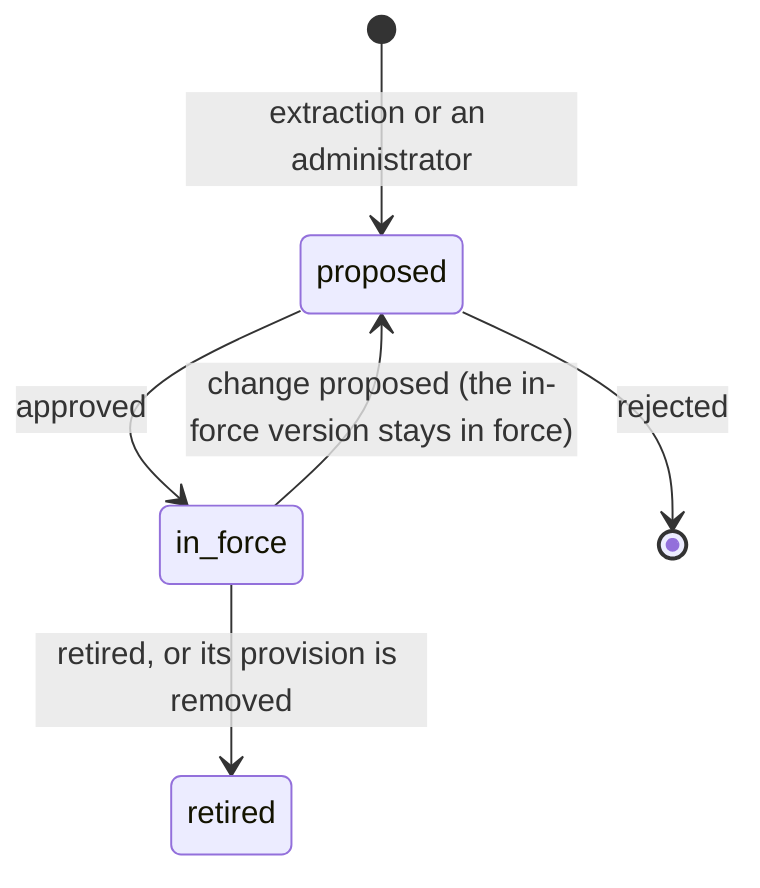

# Rule engine: the canonical rule record

> **Proposal, for review.** Replaces the catalog-first rule model in [rules.md](rules.md) and the whole-rulebook draft
> lifecycle in [extraction.md](extraction.md). Nothing here is built yet. [Migration](#migration) orders the work.

The portal manages many kinds of HOA work: architectural applications for many project types today, and other features
later (violations, maintenance requests, resale certificates, board decisions). Every one of them has to be decided
against the HOA's governing documents. The rule engine is that backbone: a complete, grounded, machine-readable record of
**every** rule and requirement in an HOA's documents, which every feature reads and cites. It's the contract for how
decisions are made.

Phase 1 got this wrong. It started from one project type: the catalog held only fences, routing discarded every section
that wasn't about a catalog project type (84 of the sample guidelines' 121 sections), and every rule had to be phrased in
fence attributes. Paint, roofs, landscaping and process rules never entered the rulebook. This page replaces that model.

## Principles

1. **Extract everything; specialize later.** Extraction records every rule in the documents, whatever it governs. What a
   feature needs is selected from the record, never decided at extraction time.
2. **The record is general; checks are optional bindings.** A rule is always stated in plain, structured terms. When a
   project type's vocabulary can express it, a typed check is bound to it so code can evaluate it; otherwise a model
   judges it from the rule's text. A missing binding never loses a rule.
3. **Everything is grounded.** Every rule points at exact passages in exact document versions, which anyone can open
   in the document viewer, highlighted. A citation is something you can check, not something you have to trust.
4. **Nothing is specific to one HOA or one project type** in code, prompts or schema. Vocabularies are data, grown from
   measured gaps across many HOAs' documents.
5. **Approved means in force.** A rule takes effect when it's approved. There's no whole-rulebook draft to publish.
6. **Measure, don't guess.** Coverage, binding rate and escape hatches are tracked per HOA and across HOAs, and
   vocabulary grows from what the measurements show.

## The layers

```text
Documents ──► Provisions ──► Rules ──► Bindings ──► Features (application review, violations, ...)
 (versions)   (citable units, (the canonical  (typed checks,   (select rules, evaluate, cite)
              anchored spans)  record)          optional)
                                 ▲
                           Vocabulary (data: subjects, attributes, values)
```

### 1. Provisions: the citable unit

OCR already produces page text with word positions. A new step splits each document version into **provisions**: the
smallest passage that states something on its own: a clause, a sub-clause, a list item, a table row, a definition.

```ts
type Provision = {
  id: string
  documentVersionId: string
  number: string | null // "5.4.1(iii)(d)", as printed
  path: string[] // ["5 Fences", "5.4 Colors", "5.4.1 Wood Fence Colors", "(iii)"]
  text: string // the full passage, verbatim
  anchors: Anchor[] // where it sits, possibly across a page break
  kind: "clause" | "list-item" | "table-row" | "definition" | "heading" | "exhibit" | "figure"
}

type Anchor = {
  pageIndex: number
  start: number // character offsets into the page's text
  end: number
  regions: Polygon[] // from Layout's word geometry; empty for Word files, which have no pages
}
```

Provisions are computed by code from Layout's paragraphs, headings and numbering. They're deterministic and cheap, so
they can be checked against the source by construction.

### 2. Rules: the canonical record

Extraction reads provisions and writes rules. The record holds what any feature needs to know and cite, with no project
type assumed:

```ts
type Rule = {
  id: string
  key: string // stable identity across versions and rebuilds
  version: number
  status: "proposed" | "in-force" | "retired"

  // What it governs. Subjects come from the vocabulary; new ones are proposed by extraction and approved.
  subjects: SubjectId[] // ["fence"], ["exterior-paint", "trim"], ["architectural-application"]
  domain: "architectural" | "use" | "maintenance" | "process" | "financial" | "governance" | "definition"

  // The rule itself, always in plain language.
  modality: "must" | "must-not" | "may" | "should" | "defines" | "procedure"
  actor: "owner" | "applicant" | "neighbor" | "committee" | "board" | "association" | "manager" | null
  requirement: string // one sentence: what must, mustn't or may happen
  applicability: Condition[] // when it applies; see below
  exceptions: Exception[] // stated exceptions, as conditions or links to other rules
  discretion: "objective" | "committee" | "board" // who decides whether it's met
  remedy: "fixable" | "not-fixable" | "variance" | null // what a homeowner can do about a failure

  // Grounding.
  citations: Citation[] // one or more; identical rules are merged into one with several citations
  authority: { documentKind: DocumentKind; precedence: number; effectiveFrom: string | null }

  // How it relates to other rules.
  relations: { kind: "amends" | "overrides" | "refines" | "conflicts-with" | "duplicates"; ruleKey: string }[]

  binding: Binding | null // layer 3; null means a model judges it from the requirement text
  provenance: Provenance
  review: { approvedBy: string | null; approvedAt: string | null; note: string | null }
}

type Citation = {
  provisionId: string
  highlight: { start: number; end: number } | null // the operative words within the provision; null = all of it
}

type Condition =
  | { type: "fact"; subject: SubjectId; attribute: AttributeKey; operator: Operator; value: Value } // typed
  | { type: "text"; id: string; description: string } // the escape hatch, measured
```

The citation's text is never typed or edited: it is the provision's text, highlighted. Quotes can't be clipped to a few
words, because there's no free-text quote at all.

Duplicate rules are detected deterministically by a normalized signature (subjects, modality, applicability,
requirement constraint), and merged into one rule with several citations. A different value on the same signature is a
conflict. **Precedence** resolves it where it can (declaration over bylaws over rules over guidelines; a later
amendment over the text it amends), and the resolution is recorded as an `overrides` relation. Only conflicts precedence
can't settle are flagged for the administrator.

### 3. Vocabulary: data, not code

The phase 1 catalog becomes a platform-wide vocabulary stored as data and versioned:

- **Subjects** ("fence", "gate", "exterior-paint", "roof", "solar-panels", "pool", "landscaping", "satellite-dish",
  "architectural-application", "lease"), with synonyms and parent subjects ("gate" is part of "fence").
- **Attributes** per subject (key, type, unit, enum values): "fence.height" in inches, "exterior-paint.color" text.
  HOA-specific allowed values stay in rules, never in the vocabulary.
- **Components**: a subject can be part of another ("a gate is part of a fence run"), which replaces the fence-specific
  gate-to-segment link.

Extraction may propose a new subject or attribute when nothing fits. A proposal goes to the platform's vocabulary
review, not into one HOA's rulebook, so every HOA benefits and no HOA's wording shapes the schema alone.

### 4. Bindings: typed checks, optional

A binding is how code evaluates a rule. It's derived from the rule when the vocabulary can express it, and can be
replaced without changing the rule:

```ts
type Binding =
  | { type: "allowed-values"; attribute: AttributeKey; values: AllowedValue[]; otherwise: "fail" | "committee" }
  | { type: "allowed-values-by"; keyAttribute: AttributeKey; attribute: AttributeKey; table: Row[] }
  | { type: "range"; attributes: AttributeKey[]; min: number | null; max: number | null }
  | { type: "matches"; attribute: AttributeKey; other: AttributeKey } // across components via part-of
  | { type: "required-fact"; attribute: AttributeKey }
  | { type: "required-document"; document: DocumentRequirementId; mustState: string[]; perComponent: boolean }
```

The phase 1 check types carry over as binding types. `qualitative` and `informational` disappear: an unbound rule is
judged by a model from its requirement, and a `procedure` or `defines` rule isn't evaluated against an application.

`required-document` gains `perComponent`, so "neighbor approval for each run on a boundary with another unit" is one
rule evaluated per component. That fixes the phase 1 warnings where a project-wide rule couldn't read a run's boundary.

### 5. Features select rules

A feature asks the engine for the rules that govern its case and gets them with their bindings and citations:

- **Architectural review**: the project type maps to subjects ("fence" means fence, gate and their parts) plus the
  rules for the `architectural-application` subject (documents, signatures, process), plus rules found by retrieval
  over the application's described scope, each with the reason it was selected.
- **Later features** select by their own subjects and domains, such as `use` and `maintenance` for violations.

## Rule lifecycle

Rules are individual, versioned records. The rulebook is the set of rules in force at a moment.



- **A build proposes changes.** Extraction compares what it finds with the rules in force and proposes additions,
  changes (a new version of an existing key) and retirements (the provision is gone). Unchanged rules aren't touched.
- **Each proposal is reviewed on its own.** Approving makes it effective at once, and a change replaces the previous
  version. Clean proposals can be approved together, as today.
- **Administrators can propose too**: a new rule, an edit, a retirement. The same review applies.
- **History is kept.** Every version stays, with who approved it and when. A review records the exact rule versions it
  used, so a decision can always be traced to the rules in force at the time.
- **Document changes are incremental.** A new amendment or a new version of the guidelines re-extracts only the
  provisions that changed.

## Editing a rule

The phase 1 editor edits prose that code doesn't evaluate, repeats the title above the fields that edit it, and asks
for citations as typed quotes. The editor becomes:

- **One place for the text.** The requirement is shown once; the list label is derived from it, so there's no separate
  title to keep in sync.
- **Citations are chosen, not typed.** "Add citation" opens the document viewer; the administrator selects a passage
  and the editor stores the provision and the highlighted range. Removing a citation is one click. A rule can't be
  approved without at least one citation.
- **The binding is editable as structure**: the attribute, the allowed values per key, the range, the conditions. Each
  field is the real thing code evaluates, with the plain-language summary generated from it. Editing the requirement
  text marks the binding for re-derivation, so prose and check can't drift apart.
- **Every field explains itself**: an info tip on modality, discretion and remedy says what it changes in a decision.

## Grounding in the UI

- **Document viewer**: `/documents/{documentId}/v/{version}?provision={id}` renders the page image with the
  provision's regions highlighted, and the text alongside. Word files render as text with the passage highlighted.
- **Every citation links there**: from the rule list, the rule panel, a review's findings, and the homeowner's view of
  their review. Homeowners and administrators see the same highlighted source.
- **Evidence in applications works the same way**: a finding's evidence links to the highlighted region of the
  homeowner's own file.

## Reviews with the rule engine

The decision policy in [review.md](review.md#8-decide) stays. What changes:

1. **Applicability before compliance.** Each selected rule is first decided as applies, doesn't apply, or unknown.
2. **Only questions that matter.** For an unknown or missing fact, code re-evaluates the rule with each possible
   answer. If no answer would change the finding's effect on the recommendation, nothing is asked; the rule is noted
   for the committee only if its discretion says so.
3. **Clarifying questions, not form fields.** The questions that matter are shown to the homeowner, each citing the rule
   that needs the answer and saying why. Answering is optional and never blocks submitting.

```ts
type Clarification = {
  id: string
  question: string
  ruleKeys: string[] // the rules that need the answer
  citations: Citation[] // why it's asked
  answer: string | null // the homeowner's words; null when skipped
  answeredAt: string | null
}
```

   Answers are stored on the application (`clarifications`) and passed to the next review run as a fact source of
   their own. A homeowner's answer counts as their statement: when it contradicts their files, the fact is
   `conflicting` and the committee sees both. The committee sees every question, answered or not.

## Measuring generality

The engine is measured across a corpus, never tuned on one HOA:

- **Corpus**: the sample HOA plus at least five other HOAs' public governing documents, of different sizes, styles and
  states. The sample application checks are a held-out test set, never used to write prompts.
- **Coverage**: provisions that state a requirement and have a rule, per document. Target: every one.
- **Binding rate**: rules with a binding, per domain. Unbound rules are fine for process and definitions; for
  architectural rules a low rate means the vocabulary is missing something.
- **Escape hatches**: text conditions and unbound architectural rules, clustered across HOAs. A cluster that recurs in
  several HOAs becomes a vocabulary proposal; one that appears in a single HOA stays text.
- **Grounding**: every citation resolves to a provision; highlights are exact substrings.
- **Stability**: two builds of the same documents propose no changes.

Phase 1's sample build, for reference: 148 rules from 37 of 121 sections; 62 (42%) qualitative, 56 text conditions;
the average quote was 16 words, and 41 of 176 were under 8.

## Prompts

Prompts stay in Langfuse with per-environment labels ([ai.md](../ai.md)). The extraction prompts change shape:

| Prompt | Input | Output |
| --- | --- | --- |
| `hoa-provision-rules` | One provision with its path, its neighbors and definitions, the vocabulary | Rules: subjects, modality, actor, requirement, applicability, exceptions, discretion, remedy, highlight |
| `hoa-rule-binding` | One rule and its subjects' attributes | A binding, or none with the reason |
| `hoa-vocabulary-proposal` | A rule no subject or attribute fits | A proposed subject or attribute, for platform review |
| `hoa-clarifying-question` | A rule, the missing fact, the application context | One question, in the homeowner's terms |

Duplicates, precedence and conflicts are code. A model is only asked about near-duplicates code can't match.

## Migration

Prototype data is disposable, so each phase replaces tables instead of migrating them.

1. **Baseline.** Datasets and metrics from [Measuring generality](#measuring-generality), run against today's engine.
2. **Provisions and the document viewer.** Anchored provisions from OCR, and the viewer with highlights. Citations in
   today's rules link to it.
3. **The rule record and extraction over every provision.** Vocabulary as data, seeded from the fence catalog plus the
   subjects the corpus shows. Routing no longer discards sections.
4. **Per-rule lifecycle and the new editor.** Proposals, approval into force, history, citation picking, binding
   editing.
5. **Reviews on the engine.** Rule selection, applicability first, questions that matter, clarifications.
6. **Vocabulary growth.** Escape hatch clustering and the platform vocabulary review.

## Open questions

- **Precedence**: is the default order right for every state, or should an HOA be able to set it? Governing law
  usually fixes it, so the proposal is a platform default with an override per HOA.
- **Vocabulary ownership**: who approves platform vocabulary proposals, and how quickly do they reach HOAs?
- **Cost**: extraction runs once per provision per document version on the strongest model. That's affordable at
  onboarding, but bulk amendments need a budget per HOA.
